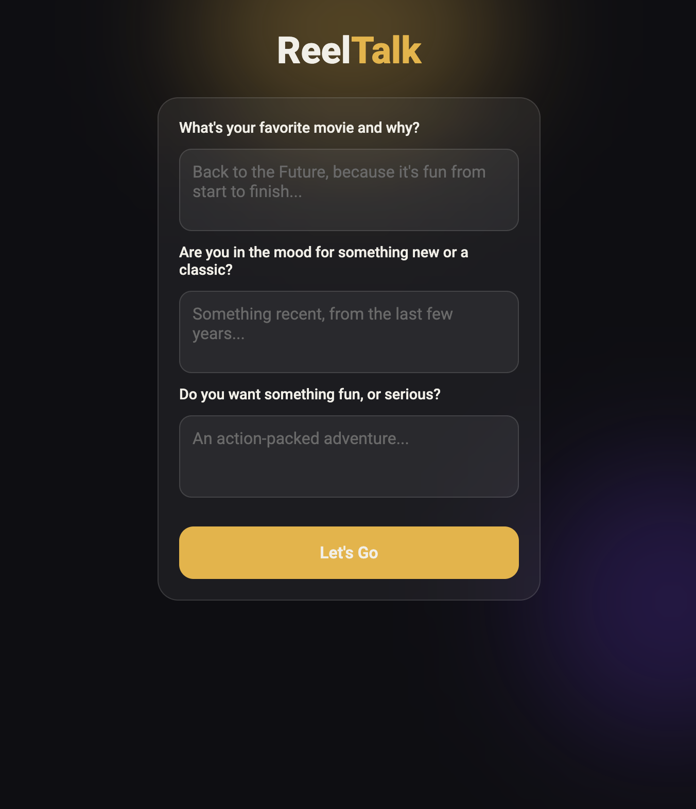
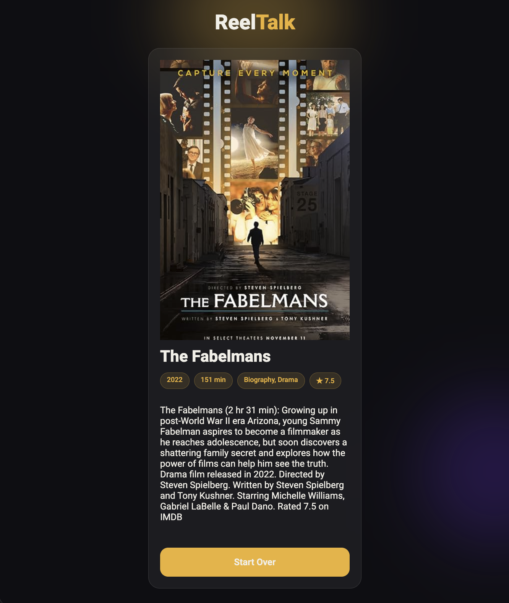

# ReelTalk

A movie recommendation app that turns your answers to three quick questions into an AI embedding and finds the movies closest in meaning using a Supabase vector database, built with Vite and vanilla HTML, CSS, and JavaScript.

  
  &nbsp;
  

## Features

- Answer three questions about your taste and mood, and ReelTalk finds your top 3 matches
- Matches are found by meaning, not keywords.
- Loading state between pages
- Proper error handling
- Dark cinema-night theme with amber glows and frosted-glass cards, designed mobile-first

## Built With

- **HTML5**
- **CSS3**: Flexbox layout, custom properties, `backdrop-filter` glass effects, transitions
- **JavaScript**: DOM manipulation, the Fetch API, `async` / `await`, `try` / `finally`
- **[OpenAI API](https://platform.openai.com/)**: `text-embedding-3-small` model that turns text into embeddings
- **[Supabase](https://supabase.com/)**: PostgreSQL with pgvector for similarity search
- **[OMDb API](https://www.omdbapi.com/)**: movie posters and details
- **Vite**: dev server and environment variables

## Skills Showcased

- Creating embeddings and storing them in a vector database with a one-time seed script
- Writing a SQL function that ranks movies by cosine similarity, called from JavaScript with `supabase.rpc()`
- Securing a database table with Row Level Security policies
- Combining two APIs and handling missing data like `"N/A"` values and failed lookups
- Tracking app state with an array and an index, and switching between two views on one page
- Building elements with `createElement` and `textContent` instead of `innerHTML`
- Keeping API keys out of version control with `.env` and `.gitignore`
